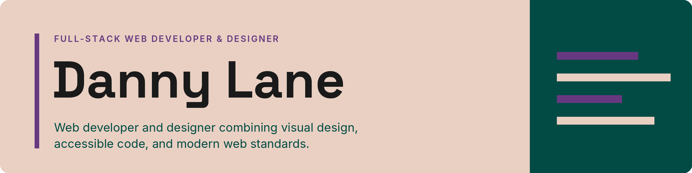
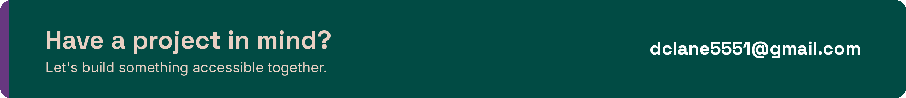

  

  
  
  

## **About Me**

I'm a web developer and designer who combines visual design, accessible code, and modern web standards. I'm earning a **BS in Graphic Information Technology (Full Stack Web Development)** at **Arizona State University** (Dean's List), and I work as a **freelance website developer for [Rhythia](https://rhythia.com)**, a rhythm-game community.

After graduation I'm looking for a front-end or full-stack developer role on a product or agency team.

## **Currently**

- **Building:** new features for [challengemaps.net](https://challengemaps.net) and the weapon set for AIMBOUND
- **Open to:** freelance work, internships, and full-time roles

## **Featured Projects**

Each project links to a full case study covering the objective, my process, and the results.

### [From Spreadsheet to Scoreboard: Dive's Challenge Maps](https://github.com/dclane5551/challenge-maps)

- **Objective:** Replace the community spreadsheet of 484 challenge maps with a website where players can browse every tier, download maps, and submit scores for review.
- **My role:** Solo developer, from data modeling to the moderated submission workflow.
- **Result:** Live at [challengemaps.net](https://challengemaps.net) and now the community's reference for every challenge map.
- **Built with:** WordPress · PHP · JavaScript · CSS

➜ **[Read the case study](https://github.com/dclane5551/challenge-maps)**

### [Every Claim Comes With a Receipt: Civic Threads](https://github.com/dclane5551/civic-threads)

- **Objective:** For an ASU team project, build a WooCommerce store for a sustainable apparel brand where every sustainability claim can be verified.
- **My role:** CSS foundation and component shells, then lead quality assurance for accessibility, responsiveness, and data accuracy.
- **Result:** Launched on time at [civicthreads.store](https://civicthreads.store), with a QA fix list covering date formatting, empty-data states, contrast, and keyboard access.
- **Built with:** WordPress · WooCommerce · Advanced Custom Fields · CSS

➜ **[Read the case study](https://github.com/dclane5551/civic-threads)**

### [Progress You Earn With Your Aim: AIMBOUND](https://github.com/dclane5551/aimbound)

- **Objective:** Design and build a skill-based action RPG on Roblox where progression rewards precision, not time spent.
- **My role:** Solo designer and developer, built with AI-assisted development (Claude Code): game design, systems architecture, testing, and balancing.
- **Result:** A working core loop with procedural levels, randomized loot, combat, and a skill-tree framework, in active development.
- **Built with:** Luau · Roblox Studio · Blender

➜ **[Read the case study](https://github.com/dclane5551/aimbound)**

## **Tech Stack**

**Languages:** HTML · CSS · JavaScript · PHP · Luau

  

**CMS:** WordPress · WooCommerce · Advanced Custom Fields

  

**Tools:** Git · GitHub · VS Code · Blender · Roblox Studio

  

## **Accessibility First**

I build with semantic HTML, test contrast and keyboard navigation against WCAG, and check that layouts hold up across viewports. Accessibility is part of how I build from the start, not a final checklist.

## **Contact**

- **Email:** [dclane5551@gmail.com](mailto:dclane5551@gmail.com)
- **Website:** [dclane5551.com](https://dclane5551.com)
- **LinkedIn:** [linkedin.com/in/dclane5551](https://www.linkedin.com/in/dclane5551/)
- **GitHub:** [github.com/dclane5551](https://github.com/dclane5551)

  

